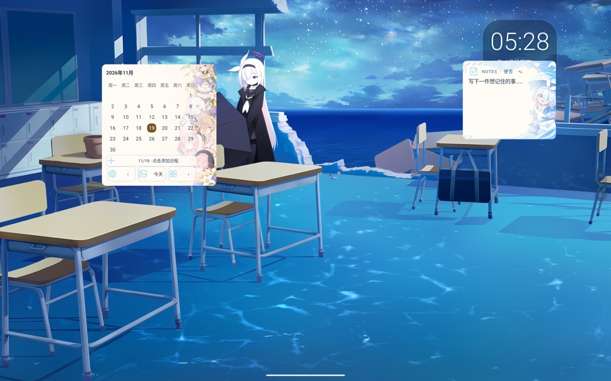
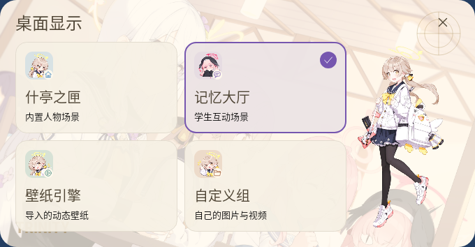
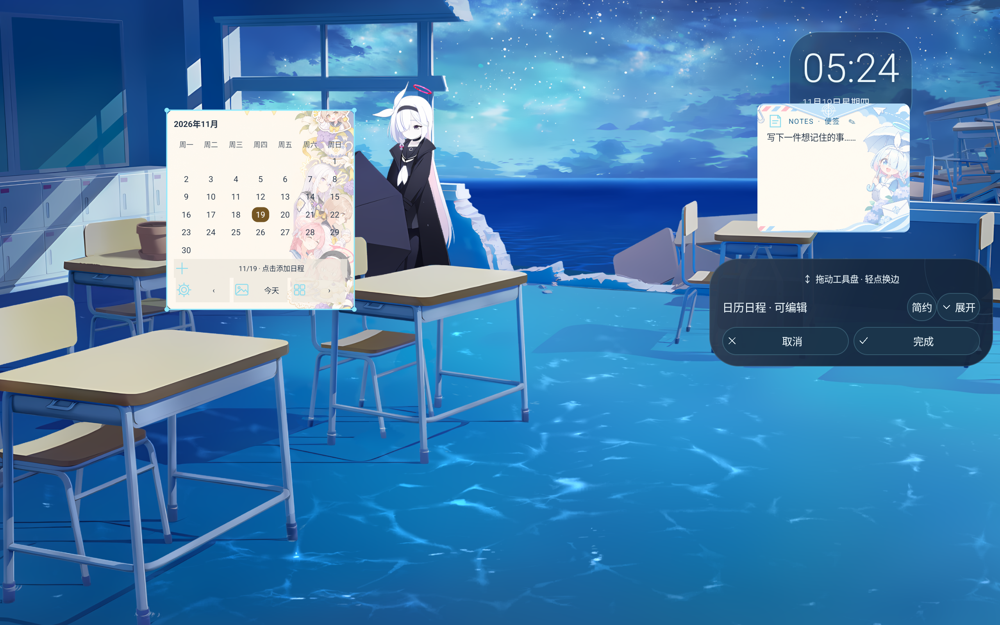
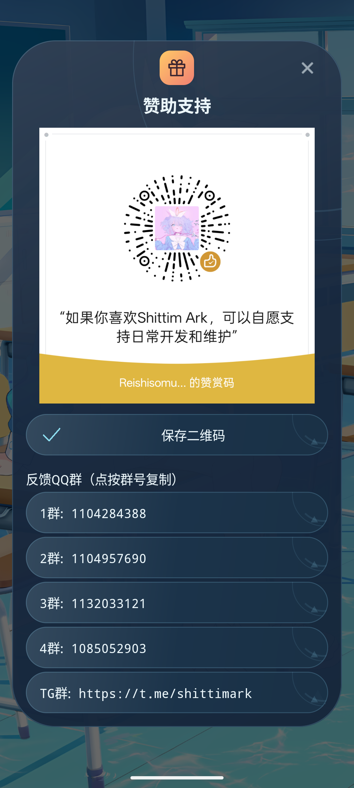

# Shittim Ark

[简体中文](README.md) · [繁體中文](README.zh-TW.md) · **English** · [日本語](README.ja.md) · [한국어](README.ko.md)

Shittim Ark is an Android launcher made by a *Blue Archive* fan. Set it as your home screen to open your everyday apps from a student's Memorial Lobby, or use a scene as live wallpaper with your current launcher.

**[Download version 1.0.0.1 for Android](https://github.com/Reishisomu/ShittimArk-Public/releases/download/1.0.0.1/ShittimArk-1.0.0.1.apk)** · [Release notes](https://github.com/Reishisomu/ShittimArk-Public/releases/tag/1.0.0.1) · [Website](https://dreamheart-atelier.pages.dev/?lang=en)



## Make yourself at home

| Choose a scene | Arrange your widgets |
| --- | --- |
|  |  |
| Open **Desktop settings → Start desktop → Desktop display**. Shittim Chest changes from day to night. Memorial Lobby lets you invite students, and Custom group can cycle through your own photos and videos. | Open **Desktop settings → Global customization → Desktop widgets** and enter the widget preview. Drag the clock, calendar and notes into place, or add a desktop pet or music player. |

- **Memorial Lobby** remembers the framing, filters and interaction settings for each student. Set a duty roster if you'd like several students to take turns.
- **Academy themes** let you choose colors, fonts and panel finishes. Switch to Immersive mode to hide the desktop controls and enjoy the scene.
- **Apps and the taskbar** can be organized into groups. Pin frequently used apps to the taskbar and open the rest from the app list.

## Install and update

Shittim Ark runs on **ARM64 phones and tablets with Android 8.0 or later**. The current release is **1.0.0.1 (build 107)**. Public release date: November 20, 2026.

The academy emblem now has its own space next to the settings mode switch and in the support dialog. Both the switch and the close button stay clear in portrait and landscape.

1. Download `ShittimArk-1.0.0.1.apk`, open it on your device and follow the Android installer. If you already have Shittim Ark, choose **Update** to keep your settings and imported resources.
2. Go to **Desktop settings → System settings → Set up system home** to make Shittim Ark your launcher. To keep your current launcher, choose **Use live wallpaper only** in System settings.
3. Open **Desktop settings → About this desktop → Check signed updates** to see the published version and its signature verification result. This release removes the old preview's expiry date.

<details>
<summary>Verify the APK</summary>

The file is 378,501,687 bytes. Its SHA-256 checksum is

```text
dbca171bec4368bd0b4f39c95de52ea4abdabc96cc04e8bb1da2dbf252d8ba1f
```

[Previous releases and resources](https://github.com/Reishisomu/ShittimArk-Public/releases)

</details>

## Feedback and support

Open **Desktop settings → About this desktop → Support the developer** to find the four QQ feedback groups and the [Telegram group](https://t.me/shittimark). Tap a QQ group number to copy it. If you're reporting a layout issue, a screenshot, your device model and Android version help the developer reproduce it.

You can also leave a voluntary tip via WeChat on that page. To use the code on the same phone, tap **Save QR code**, then open the image from your album in the WeChat scanner.

<details>
<summary>See the support and feedback screen</summary>



</details>

Shittim Ark is an unofficial *Blue Archive* fan project maintained by Reishisomu. Characters, artwork, music and third-party materials belong to their respective rights holders. The project notice is available under **About this desktop** in the app. This repository hosts the download site, APK releases and release information.
