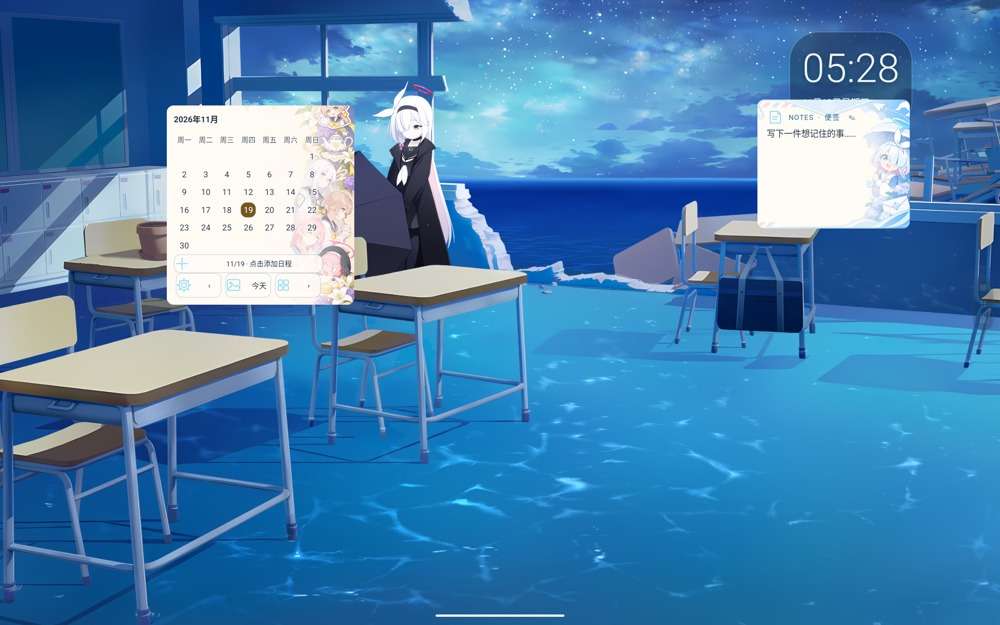
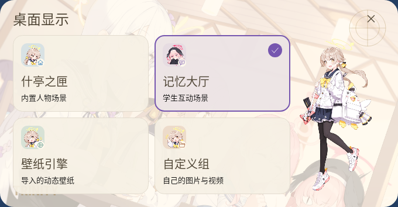
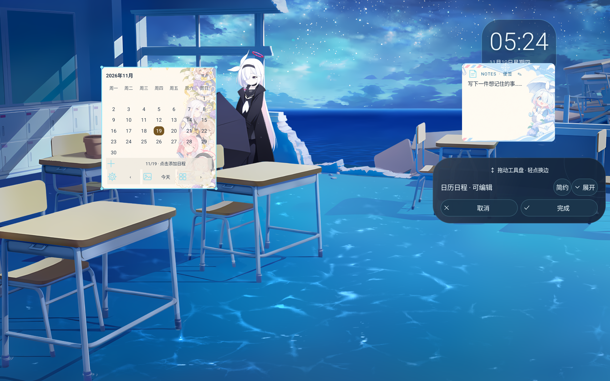
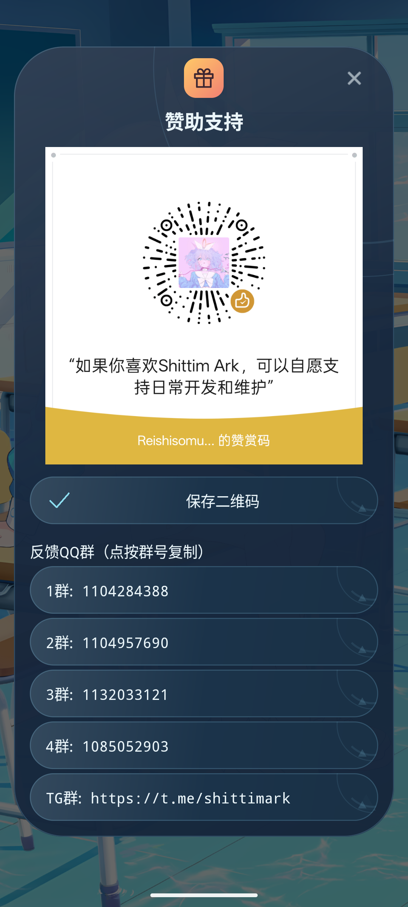

# シッテム・アーク · Shittim Ark

[简体中文](README.md) · [繁體中文](README.zh-TW.md) · [English](README.en.md) · **日本語** · [한국어](README.ko.md)

シッテム・アークは、『ブルーアーカイブ』のファンが制作した Android 用ホームアプリです。既定のホームに設定すると、お気に入りの生徒がいる画面から、いつも使うアプリを開けます。今のホーム画面やアイコンの配置をそのまま使いたい方は、ライブ壁紙だけを楽しむこともできます。

**[Android 正式版 1.1.1.0 をダウンロード](https://github.com/Reishisomu/ShittimArk-Public/releases/download/1.1.1.0/ShittimArk-1.1.1.0.apk)** · [公式サイトからダウンロード](https://dreamheart-atelier.pages.dev/downloads/ShittimArk-1.1.1.0.apk)　·　[今回の更新内容](https://github.com/Reishisomu/ShittimArk-Public/releases/tag/1.1.1.0)　·　[配布サイト](https://dreamheart-atelier.pages.dev/?lang=ja)



## ホーム画面を自分好みに

| シーンを選ぶ | ウィジェットを並べる |
| --- | --- |
|  |  |
| 「ホーム設定 → デスクトップを開始 → ホームの表示」でシーンを切り替えます。「シッテムの箱」では昼と夜で景色が変わり、「メモリアルロビー」では生徒を招待できます。「カスタムグループ」では、自分の画像や動画を順番に再生できます。 | 「ホーム設定 → 全体のカスタマイズ → ホームウィジェット」から「ウィジェットプレビュー」を開くと、時計やカレンダー、付箋をドラッグして配置できます。デスクトップペットや音楽プレーヤーも追加できます。 |

- **メモリアルロビー**では、画面の構図やフィルター、タップしたときの反応を生徒ごとに保存できます。何人かの生徒に交代で会いたいときは、当番表を組んでみてください。
- **学園ごとのデザイン**に好きな配色やフォント、ポップアップの質感を組み合わせられます。生徒の姿をじっくり眺めたいときは、「鑑賞モード」に切り替えてホーム画面の操作ボタンを隠せます。
- **アプリとドック**は使い方に合わせてグループ分けできます。よく使うアプリはドックに固定し、ほかはアプリ一覧から開けば、ホーム画面にお気に入りのシーンを広く表示できます。

## インストールと更新

**Android 8.0 以降を搭載した ARM64 のスマートフォンとタブレット**に対応しています。今回の正式版は **1.1.1.0（125）** です。 正式版の公開日は 2026 年 11 月 22 日です。

フローティングアイランドは、電池残量リング付きのカプセル型と、小さなボール型から選べます。タップすると曲名を確認したり、明るさや音量を調整したりできます。クラシックと13種類の学園スキンには、公式の立ち絵を参考に描いた、背景が透明な生徒のファンアートを用意しました。1.1.0.0 から初めて更新すると、時計は背景なしの「花便りの手書き」、画面フォントは「アート · キャンディラウンド」になります。この変更は一度限りで、時計の文字サイズは引き継がれます。

1. 上のリンクから `ShittimArk-1.1.1.0.apk` をダウンロードし、Android 端末で開いて画面の案内に従ってください。旧版をお使いの先生は、そのまま「更新」を選ぶと設定や取り込み済みの素材を引き継げます。
2. シッテム・アークを開き、「ホーム設定 → システム設定 → ホームアプリを設定」から既定のホームに設定します。今お使いのホームを引き続き使いたい場合は、「システム設定」で「ライブ壁紙のみ使用」を選んでください。
3. 以降は「ホーム設定 → ホームについて → 署名付き更新を確認」で、公開中のバージョンと配信リストの署名検証結果を確認できます。正式版では、旧プレビュー版に設けていた利用期限を撤廃しました。

<details>
<summary>インストールファイルを照合する</summary>

ファイルサイズは 380,178,624 バイトです。ダウンロードした APK の SHA-256 を次の値と照合できます。

```text
7e55dd852e4a10b9c9df525896e6e7b503791e24a5d64f1dcbc63aafc7469356
```

[過去のバージョンと配布ファイル](https://github.com/Reishisomu/ShittimArk-Public/releases)

[1.1.0.0 の更新内容](https://github.com/Reishisomu/ShittimArk-Public/releases/tag/1.1.0.0) · ホームの設定項目とスイッチが学園のイラスト上に直接表示されます。検索欄に入力すると枠線が明るくなり、お気に入りは複数選んでまとめて解除できます。

</details>

## フィードバックと開発の応援

**「ホーム設定 → ホームについて → 開発者を応援」** には、フィードバック用の QQ グループが4つと、[Telegram グループ](https://t.me/shittimark)へのリンクがあります。QQ のグループ番号はタップするとコピーできます。表示の崩れを報告するときは、端末の機種名、Android のバージョン、該当画面のスクリーンショットを添えていただけると助かります。

シッテム・アークを気に入っていただけたら、この画面から WeChat で日々の開発を応援していただけます。応援は任意です。スマートフォン1台で読み取るには、「QR コードを保存」をタップし、WeChat のスキャン画面で保存した画像を選んでください。

<details>
<summary>アプリの応援・フィードバック画面を見る</summary>



</details>

シッテム・アークは Reishisomu が個人で開発・運営する『ブルーアーカイブ』の非公式ファンプロジェクトです。キャラクター、イラスト、音楽、その他の第三者素材の権利は、それぞれの権利者に帰属します。プロジェクトの詳細はアプリ内の「ホームについて」にある「プロジェクト説明と免責事項」をご覧ください。このリポジトリでは、ダウンロードページ、インストールファイル、リリース情報を公開しています。
