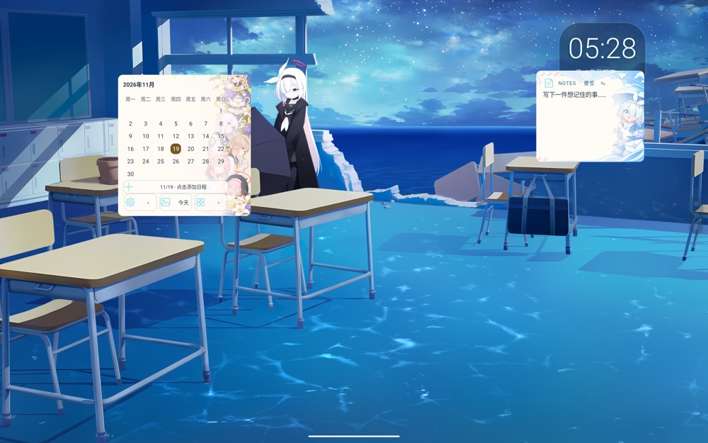
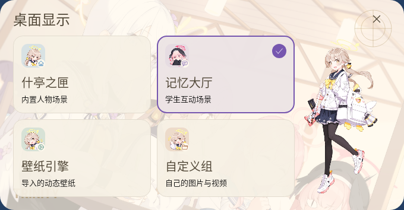
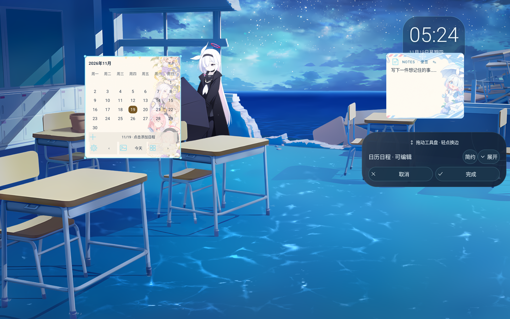
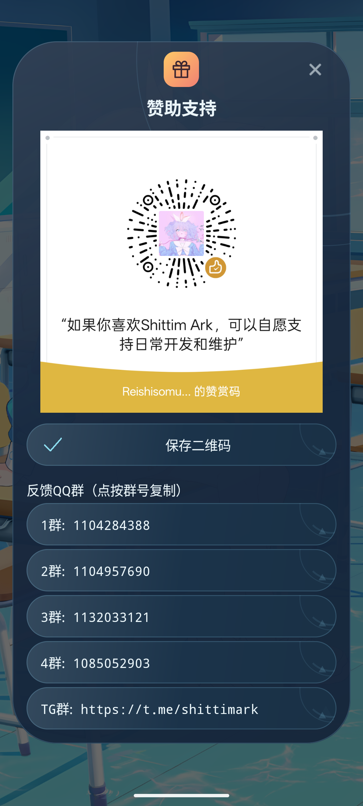

# Shittim Ark

[简体中文](README.md) · [繁體中文](README.zh-TW.md) · [English](README.en.md) · [日本語](README.ja.md) · **한국어**

Shittim Ark는 《블루 아카이브》를 즐기는 선생님이 만든 안드로이드 런처입니다. 기본 홈 앱으로 설정하면 좋아하는 학생과 함께하는 홈 화면에서 자주 쓰는 앱을 열 수 있습니다. 지금 쓰는 홈 화면의 배치를 그대로 두고 라이브 배경화면만 사용하는 것도 가능합니다.

**[안드로이드 정식 버전 1.1.0.0 다운로드](https://github.com/Reishisomu/ShittimArk-Public/releases/download/1.1.0.0/ShittimArk-1.1.0.0.apk)** · [공식 사이트에서 다운로드](https://dreamheart-atelier.pages.dev/downloads/ShittimArk-1.1.0.0.apk) · [이번 버전의 변경 사항](https://github.com/Reishisomu/ShittimArk-Public/releases/tag/1.1.0.0) · [프로젝트 웹사이트](https://dreamheart-atelier.pages.dev/?lang=ko)



## 나만의 홈 화면 꾸미기

| 장면 선택 | 위젯 배치 |
| --- | --- |
|  |  |
| ‘홈 설정 → 데스크톱 시작 → 홈 화면 표시’에서 장면을 바꿔 보세요. 싯딤의 상자에서는 낮과 밤이 바뀌고, 메모리얼 로비에는 학생을 초대할 수 있습니다. 사용자 그룹에서는 내 사진과 동영상을 번갈아 재생할 수 있습니다. | ‘홈 설정 → 전체 사용자 설정 → 홈 위젯’에서 위젯 미리보기를 여세요. 시계, 달력, 메모를 끌어서 원하는 곳에 놓고 바탕화면 펫이나 음악 플레이어도 추가할 수 있습니다. |

- **메모리얼 로비**에서는 학생마다 화면 구도, 필터, 상호작용 설정을 따로 저장할 수 있습니다. 여러 학생을 번갈아 만나고 싶다면 당번표를 짜 보세요.
- **학원 테마**는 원하는 색상과 글꼴, 팝업 배경의 질감을 조합해 꾸밀 수 있습니다. 학생을 더 잘 보고 싶을 때는 감상 모드로 전환해 홈 화면의 조작 버튼을 숨길 수 있습니다.
- **앱과 작업 표시줄**은 사용 습관에 맞게 그룹으로 정리할 수 있습니다. 자주 쓰는 앱만 작업 표시줄에 고정하고 나머지는 목록에서 열면 홈 화면에 좋아하는 장면을 더 넓게 담을 수 있습니다.

## 설치 및 업데이트

**안드로이드 8.0 이상을 사용하는 ARM64 스마트폰과 태블릿**을 지원합니다. 이번 정식 버전은 **1.1.0.0(117)**입니다. 정식 버전 공개일은 2026년 11월 22일입니다.

홈 설정의 작업 항목과 스위치가 학원 일러스트 위에 바로 표시됩니다. 검색창을 누르면 테두리가 밝아지고, 즐겨찾기는 여러 항목을 골라 한 번에 삭제할 수 있어요.

1. 위 링크에서 `ShittimArk-1.1.0.0.apk`를 다운로드한 뒤 안드로이드 기기에서 파일을 열고 안내에 따라 설치하세요. 이전 버전이 설치되어 있다면 ‘업데이트’를 선택하세요. 기존 설정과 가져온 자료가 그대로 유지됩니다.
2. Shittim Ark를 열고 ‘홈 설정 → 시스템 설정 → 시스템 홈 설정’에서 기본 홈 앱으로 지정하세요. 기존 홈 앱을 계속 쓰려면 같은 화면에서 ‘라이브 배경화면만 사용’을 선택하세요.
3. 이후 ‘홈 설정 → 홈 정보 → 서명된 업데이트 확인’에서 공개된 버전과 배포 목록의 서명 검증 결과를 확인할 수 있습니다. 정식 버전에는 이전 미리보기 버전의 사용 기한이 없습니다.

<details>
<summary>설치 파일 확인</summary>

파일 크기는 378,564,281바이트입니다. 다운로드한 파일의 SHA-256 해시가 아래 값과 일치하는지 확인하세요.

```text
17890cdf4d0b431eacb1cf5304dcde79d4e98505756fbba1364fd6737a10077e
```

[이전 버전 및 자료](https://github.com/Reishisomu/ShittimArk-Public/releases)

</details>

## 피드백 및 후원

**‘홈 설정 → 홈 정보 → 개발자 후원’**에서 피드백을 받는 QQ 그룹 네 곳과 [텔레그램 그룹](https://t.me/shittimark)을 찾을 수 있습니다. QQ 그룹 번호를 누르면 번호가 복사됩니다. 화면 배치가 어긋난다면 기기 모델명과 안드로이드 버전, 문제가 보이는 스크린샷을 함께 보내 주세요. 개발자가 해당 화면을 찾는 데 도움이 됩니다.

Shittim Ark가 마음에 드셨다면 같은 페이지에서 위챗으로 개발과 유지 관리를 후원하실 수 있습니다. 같은 휴대폰에서 이용할 때는 ‘QR 코드 저장’을 누른 뒤 위챗의 스캔 화면에서 앨범에 저장한 코드를 선택하세요.

<details>
<summary>앱에서 후원 및 피드백 메뉴 보기</summary>



</details>

Shittim Ark는 Reishisomu가 혼자 개발하고 관리하는 《블루 아카이브》의 비공식 팬 프로젝트입니다. 캐릭터, 일러스트, 음악 및 제3자 자료에 대한 권리는 각 권리자에게 있습니다. 프로젝트 관련 안내는 앱의 ‘홈 정보’에서 확인할 수 있습니다. 이 저장소에서는 공개 다운로드 페이지와 설치 파일, 릴리스 자료를 관리합니다.
