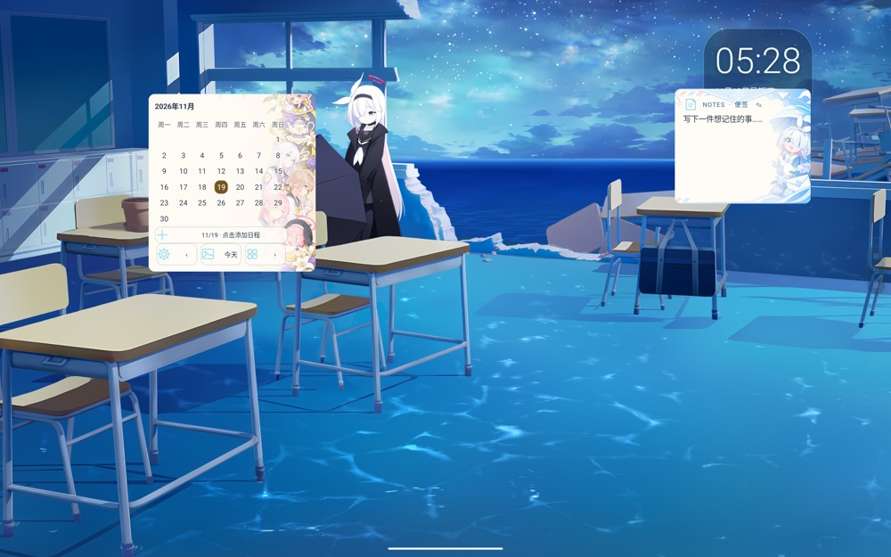
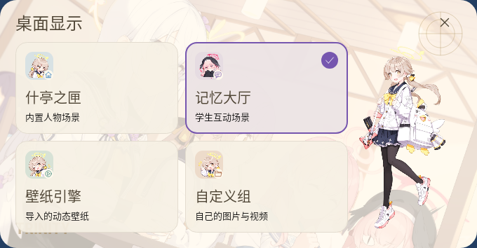
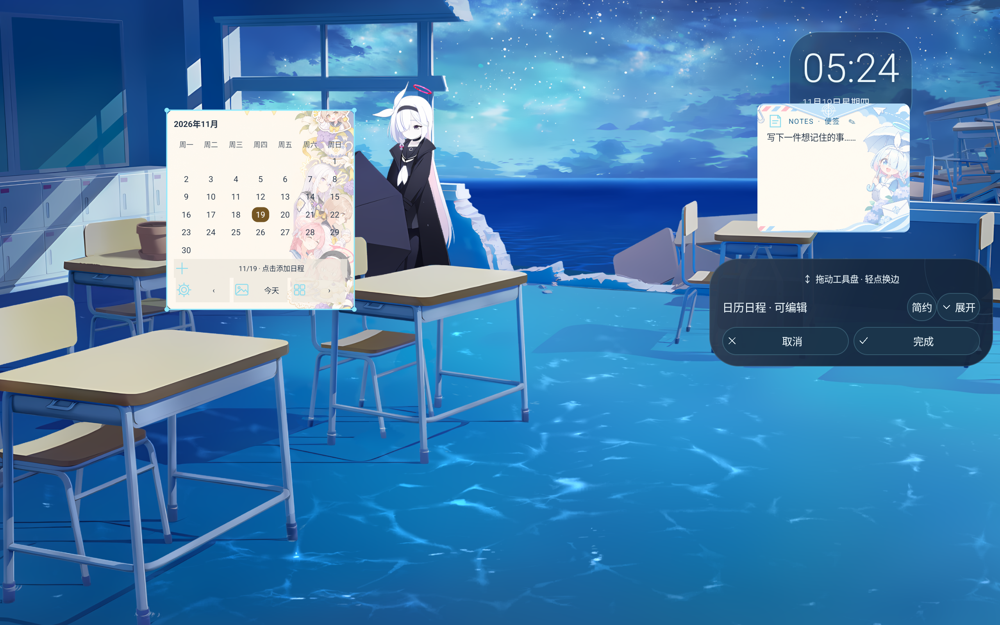
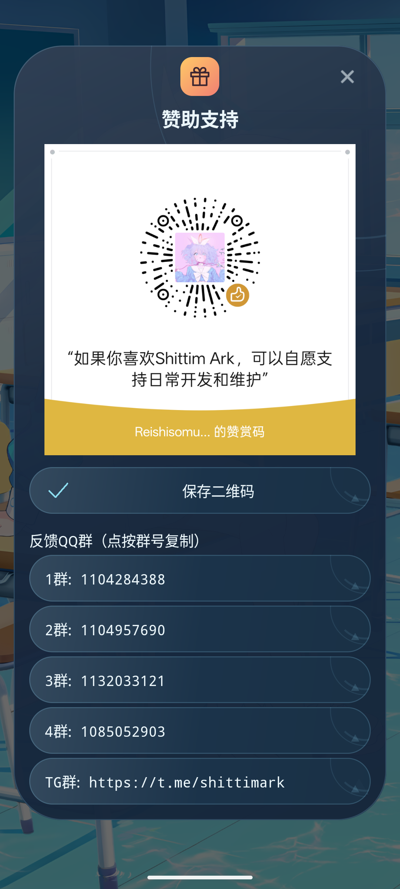

# 什亭方舟 · Shittim Ark

**简体中文** · [繁體中文](README.zh-TW.md) · [English](README.en.md) · [日本語](README.ja.md) · [한국어](README.ko.md)

什亭方舟是一款由《碧蓝档案》玩家制作的 Android 桌面。把它设为默认桌面，就能在喜欢的学生身边打开常用应用。想保留现在的桌面布局，也可以单独使用动态壁纸。

**[下载 Android 正式版 1.0.0.0](https://github.com/Reishisomu/ShittimArk-Public/releases/download/1.0.0.0/ShittimArk-1.0.0.0.apk)**　·　[查看本版更新](https://github.com/Reishisomu/ShittimArk-Public/releases/tag/1.0.0.0)　·　[访问官网](https://dreamheart-atelier.pages.dev/)



## 你的桌面可以这样布置

| 选择场景 | 摆放小组件 |
| --- | --- |
|  |  |
| 在「桌面设置 → 开始桌面 → 桌面显示」切换场景。什亭之匣有昼夜变化，记忆大厅可以邀请学生，自定义组可以轮播自己的图片和视频。 | 在「桌面设置 → 全局定制 → 桌面小组件」打开组件预览，拖动时钟、日历和便签调整位置，还能加上桌宠或音乐播放器。 |

- **记忆大厅**可以单独保存每位学生的构图、滤镜与互动设置。想轮流见到几位学生，可以安排值班表。
- **学院外观**可以搭配自己喜欢的配色、字体和弹窗材质。想让角色更醒目，可以收起桌面控件，切到纯享模式。
- **应用和任务栏**可以按习惯分组。常用应用放进固定任务栏，其余应用从列表打开，桌面留给喜欢的场景。

## 安装和更新

适用于 **Android 8.0 及以上的 ARM64 手机和平板**。本次正式版为 **1.0.0.0（106）**。

1. 下载上方的 `ShittimArk-1.0.0.0.apk`，在 Android 设备上打开，按系统提示安装。已装旧版的老师直接选择更新即可，覆盖安装会保留设置和导入的资源。
2. 打开什亭方舟，进入「桌面设置 → 系统设置 → 设置系统桌面」，就能把它设为默认桌面。想继续用原来的桌面，请选择同页的「仅用动态壁纸」。
3. 后续可以在「桌面设置 → 关于桌面 → 检查已签名更新」查看公开版本和发布清单签名的验证结果。正式版已移除旧预览版的使用期限。

<details>
<summary>核对安装包</summary>

文件大小为 378,501,311 字节。下载文件的 SHA-256 应为

```text
6d84adce226a334b74daff6751a255cc8b562ee9ff1b4cb3518eff7a173db4eb
```

[历史版本与资源](https://github.com/Reishisomu/ShittimArk-Public/releases)

</details>

## 反馈与支持

在 **「桌面设置 → 关于桌面 → 赞助支持」** 可以找到四个反馈 QQ 群和 [Telegram 群](https://t.me/shittimark)。点一下群号即可复制。遇到布局问题时，带上设备型号、Android 版本和一张截图，作者更容易找到对应的界面。

如果你喜欢什亭方舟，也可以在这个页面用微信自愿支持日常开发。使用同一台手机时，点「保存二维码」，再到微信从相册识别即可。

<details>
<summary>查看 App 内的赞助与反馈入口</summary>



</details>

什亭方舟由 Reishisomu 独立维护，是《碧蓝档案》的非官方同人项目。角色、美术、音乐及第三方素材的权利归各自权利人所有，项目声明可在 App 的「关于桌面」中查看。本仓库用于维护公开下载页、安装包和发布资料。
