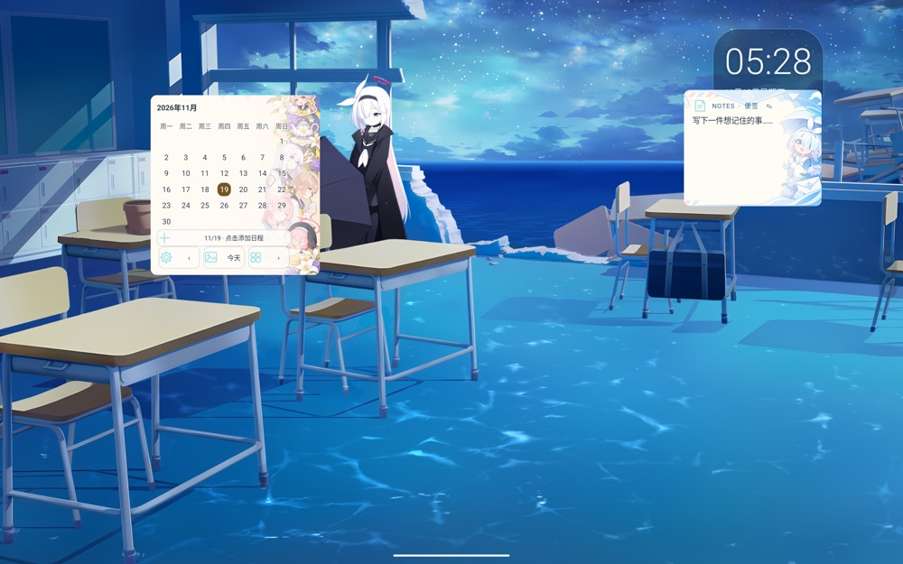
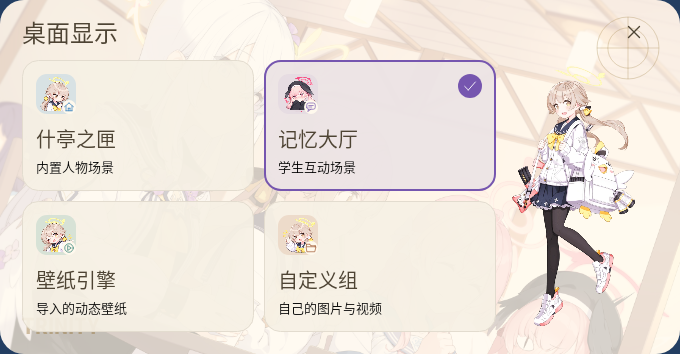
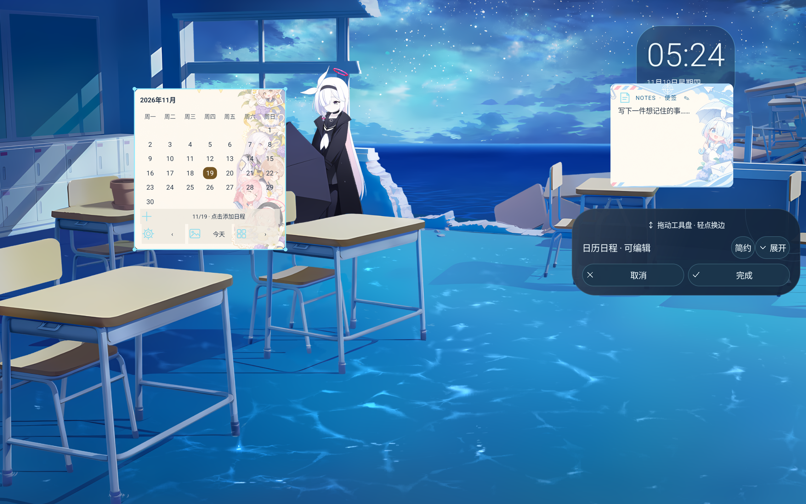
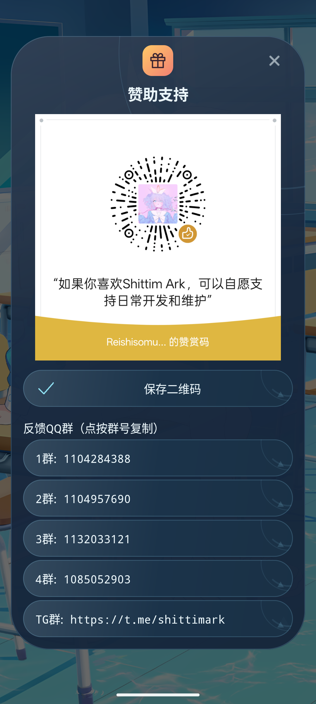

# 什亭方舟 · Shittim Ark

[简体中文](README.md) · **繁體中文** · [English](README.en.md) · [日本語](README.ja.md) · [한국어](README.ko.md)

什亭方舟是由《蔚藍檔案》玩家製作的 Android 桌面。設為預設桌面後，每次開啟常用的應用程式，都能看到喜歡的學生。想保留現在的主畫面配置，也可以只使用動態桌布。

**[下載 Android 正式版 1.1.1.0](https://github.com/Reishisomu/ShittimArk-Public/releases/download/1.1.1.0/ShittimArk-1.1.1.0.apk)** · [從官網直接下載](https://dreamheart-atelier.pages.dev/downloads/ShittimArk-1.1.1.0.apk)　·　[查看本版更新內容](https://github.com/Reishisomu/ShittimArk-Public/releases/tag/1.1.1.0)　·　[前往官網](https://dreamheart-atelier.pages.dev/?lang=zh-TW)



## 布置你的桌面

以下選單名稱沿用 App 的簡體中文介面，方便對照畫面操作。

| 選擇場景 | 擺放小工具 |
| --- | --- |
|  |  |
| 在「桌面设置 → 开始桌面 → 桌面显示」切換場景。什亭之匣會隨晝夜變化，回憶大廳可以邀請學生，自訂群組則能輪播自己的相片和影片。 | 在「桌面设置 → 全局定制 → 桌面小组件」開啟小工具預覽。拖曳時鐘、月曆或便條就能調整位置，也可以加上桌寵或音樂播放器。 |

- **回憶大廳**可以為每位學生分別儲存構圖、濾鏡和互動設定。想讓幾位學生輪流出現，可以替她們排一張值日表。
- **學院外觀**可以搭配喜歡的配色、字型和彈出視窗材質。想看清楚角色時，切換到「纯享模式」就能收起桌面上的控制項。
- **應用程式和工作列**可以依照使用習慣分組。把常用的應用程式釘選到工作列，其餘的從清單開啟，桌面的空間就能留給喜歡的場景。

## 安裝與更新

支援 **Android 8.0 以上的 ARM64 手機與平板**。本次正式版為 **1.1.1.0（125）**。 正式版於 2026 年 11 月 22 日公開發布。

靈動島收起時預設為帶有電量環的膠囊，也能改成小球。點開可查看曲目、調整亮度與音量。經典與 13 個學院佈景各有一張參考官方角色立繪繪製的透明同人半身像。首次從 1.1.0.0 更新時，時鐘會換成花箋手寫並關閉底板，介面字型會換成糖果萌圓。這三項只套用一次，原有時鐘字級會保留。

1. 下載上方的 `ShittimArk-1.1.1.0.apk`，在 Android 裝置上開啟檔案，依系統提示安裝。已經安裝舊版的老師可以直接選擇更新，原有設定和匯入的資源都會保留。
2. 開啟什亭方舟，在「桌面设置 → 系统设置 → 设置系统桌面」將它設為預設桌面。如果想繼續使用原來的桌面，請在「系统设置」頁選擇「仅用动态壁纸」。
3. 日後可到「桌面设置 → 关于桌面 → 检查已签名更新」查看公開版本，以及發布清單的數位簽章驗證結果。正式版已取消舊預覽版的使用期限。

<details>
<summary>核對安裝檔</summary>

檔案大小為 380,178,624 位元組。下載檔案的 SHA-256 雜湊值應為

```text
7e55dd852e4a10b9c9df525896e6e7b503791e24a5d64f1dcbc63aafc7469356
```

[歷史版本與資源](https://github.com/Reishisomu/ShittimArk-Public/releases)

[回顧 1.1.0.0 更新內容](https://github.com/Reishisomu/ShittimArk-Public/releases/tag/1.1.0.0) · 桌面參數頁的操作項目與開關直接顯示在學院插畫上，點進搜尋欄時外框會亮起。收藏設定現在可以一次移除多個項目。

</details>

## 意見回饋與支持

在 **「桌面设置 → 关于桌面 → 赞助支持」** 可以找到四個回饋用的 QQ 群組，以及 [Telegram 群組](https://t.me/shittimark)。點一下 QQ 群號即可複製。回報畫面配置問題時，請附上裝置型號、Android 版本和螢幕截圖，方便作者找出問題所在。

喜歡什亭方舟的話，也可以在同一頁透過微信贊助日常開發。在同一支手機上，點選「保存二维码」，再從微信的掃描功能開啟相簿，選取剛儲存的讚賞碼即可。

<details>
<summary>查看 App 裡的贊助與回饋入口</summary>



</details>

什亭方舟由 Reishisomu 獨立維護，是《蔚藍檔案》的非官方同人作品。角色、美術、音樂與第三方素材的權利歸各權利人所有。專案聲明可在 App 的「关于桌面」查看。本儲存庫用來維護公開下載頁、安裝檔與版本發布資料。
